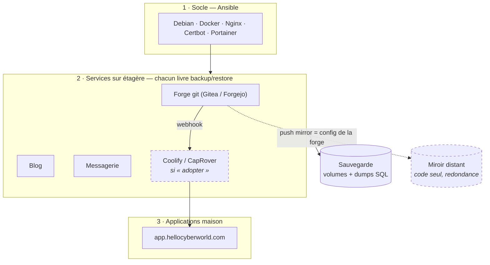

# Architecture : couches, services et plateforme

Date : 13 septembre 2026
Statut : brouillon — à relire
Remplace : la partie architecture de `09.Roadmap-Docker-Plateforme-Services.md` (dont le §12, priorité Open WebUI, est caduc : service retiré depuis). S'appuie sur `08.Architecture-Separation-Infra-Data.md` pour la séparation infra / contenu.

---

## 1) Idée centrale

La question « construire une plateforme ou adopter un outil existant » ne concerne pas tout le serveur. Elle ne concerne que **les dépôts qui deviennent des applications** (build, variables d'environnement, déploiement sur un sous-domaine). Tout le reste peut avancer sans la trancher.

On distingue donc trois couches :

| Couche | Contenu | Outil | Besoin d'une plateforme ? |
|---|---|---|---|
| 1. Socle | OS, Docker, Nginx, Certbot, Portainer | Ansible (idempotent, ne connaît aucun projet) | Non |
| 2. Services sur étagère | forge git, blog, messagerie, wiki… | image Docker + vhost + certificat, livrés par Ansible | Non |
| 3. Applications maison | ex. `app.hellocyberworld.com` construite depuis un dépôt | build + déploiement | **Oui** |

## 2) Schéma

Trait plein vers la sauvegarde : c'est le chemin de restauration. Pointillés : optionnel ou secondaire.

## 3) Code ≠ données

Le point qui structure la sauvegarde :

- Ansible restaure **le serveur** (couche 1 et la configuration des services).
- Un dépôt git restaure **du code**.
- Ni l'un ni l'autre ne restaure **les données des services** : issues et pull requests d'une forge, messages d'une messagerie, articles d'un blog vivent dans des bases de données et des volumes Docker.

Conséquence : dès le premier service qui produit des données, la sauvegarde des volumes et des bases est la seule chose qui permet de revenir en arrière.

## 4) Contrat de service (convention, pas un store)

Inspiré de YunoHost, où chaque application est livrée avec ses propres scripts de sauvegarde et de restauration : la sauvegarde n'est pas une politique globale, c'est une responsabilité portée par chaque service.

Règle : **tout service livré par Ansible fournit** :

- la liste de ses volumes à sauvegarder ;
- un dump logique (SQL) s'il a une base de données, en plus du volume brut ;
- un `backup.sh` et un `restore.sh` ;
- un test de restauration documenté (reprend la « définition de done » du 09 §8 : sauvegarde récente présente, restauration vers un volume temporaire, service qui redémarre avec les données attendues).

Ce qu'on ne construit pas : un catalogue, une interface d'installation, un système de paquets. La valeur d'un store vient de la communauté qui maintient les recettes ; pour quelques services, une convention suffit.

## 5) Forge git et miroir

- Forge candidate : Gitea ou Forgejo (légers, push mirror intégré). GitLab CE fournit aussi le push mirror mais demande nettement plus de mémoire : vérifier les prérequis officiels face à la RAM du serveur **avant** installation.
- Le miroir vers un hébergeur distant est une **fonction de la forge**, configurée par dépôt et stockée dans sa base. Aucun script de synchronisation à écrire : la configuration des miroirs est restaurée avec la sauvegarde de la forge.
- Le miroir distant est de la **redondance**, pas la sauvegarde. Restaurer depuis la sauvegarde de la forge rend dépôts + issues + utilisateurs ; restaurer depuis un miroir ne rend que le code.
- Miroirs de dépôts privés : **visibilité privée vérifiée explicitement** à la création, jamais laissée à la valeur par défaut d'un outil.
- Les dépôts hébergés sur la forge sont des données, indépendantes de ce dépôt d'infrastructure : ce dépôt peut rester public sans rien exposer d'eux.

## 6) Couche plateforme : adopter ou construire

Les outils existants n'ont pas la même forme :

| Outil | Forme | Déclenchement du déploiement |
|---|---|---|
| Dokku | installé sur l'hôte, pilote Docker, CLI | `git push` vers **son propre remote** (pas branché sur la forge par défaut) |
| CapRover | Docker Swarm + interface web | webhook depuis la forge |
| Coolify | conteneur + interface web | dépôt connecté (clé de déploiement) + webhook |

Détails d'intégration à revérifier dans la documentation de chaque outil au moment de l'arbitrage.

Conséquence pour l'arbitrage : en mode **adopter**, la plateforme n'est pas une couche à construire, c'est **un service de plus** en couche 2, installé et sauvegardé selon le contrat du §4. En mode **construire**, elle rejoint le socle et devient du code à maintenir.

## 7) Déclencheur de l'arbitrage

L'arbitrage est volontairement différé, avec une condition écrite :

> **Le premier dépôt qui demande une étape de build et au moins une variable d'environnement déclenche une session d'arbitrage plateforme** — comparaison des outils du §6 face aux besoins réels de cette application. Pas avant, pas après.

Raison : choisir pour une application connue est mieux posé que choisir pour des applications hypothétiques. Risque surveillé : si les services de couche 2 sont déployés à la main et que la première application l'est aussi « en attendant », la plateforme finit construite par défaut, sans décision.

## 8) Ordre d'exécution

1. **Sauvegarde** (volumes + dumps + test de restauration) sur le disque dédié.
2. **Forge git**, premier service à données, avec son contrat backup/restore et ses miroirs.
3. Autres services sur étagère (blog, messagerie, wiki), un par un, chacun avec son contrat.
4. Arbitrage plateforme quand le déclencheur du §7 se produit.

La sauvegarde passe avant le premier service à données : l'installer après, c'est laisser la première donnée produite sans protection.

## 9) Hors périmètre de ce document

- Choix définitif de la forge (Gitea / Forgejo / GitLab).
- Stratégie d'externalisation des sauvegardes (hors site).
- Identité / SSO commune aux services.
